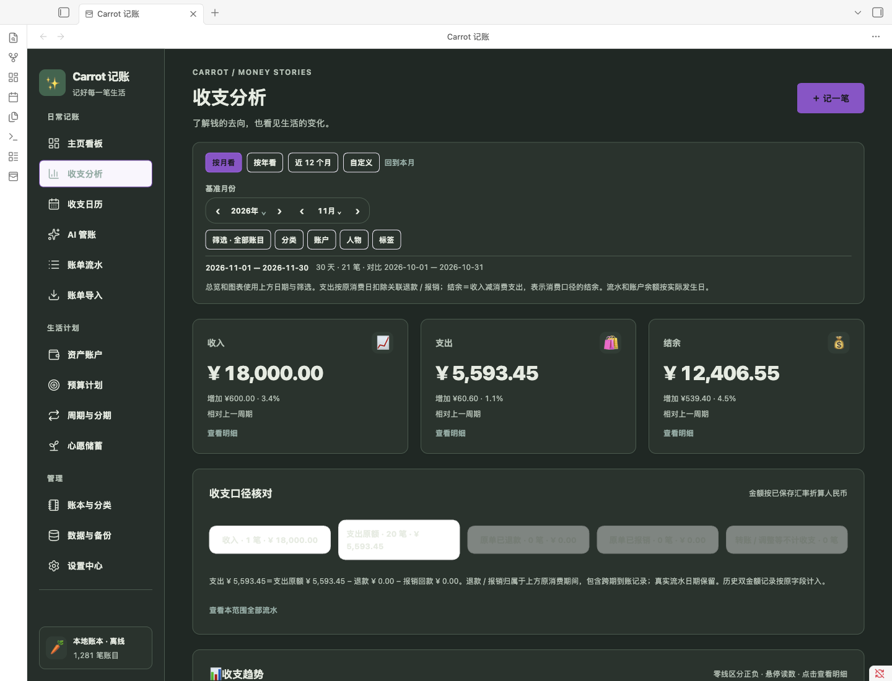
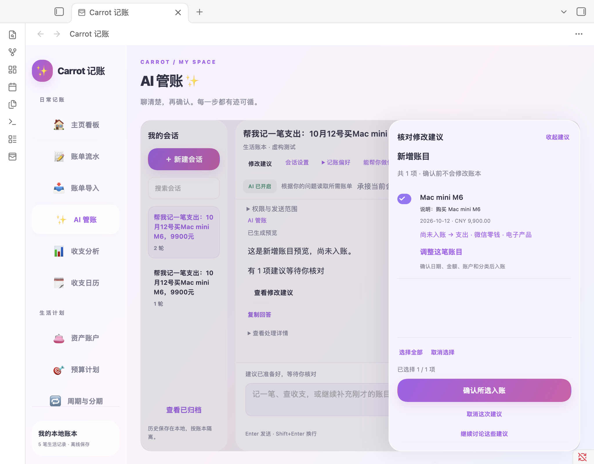
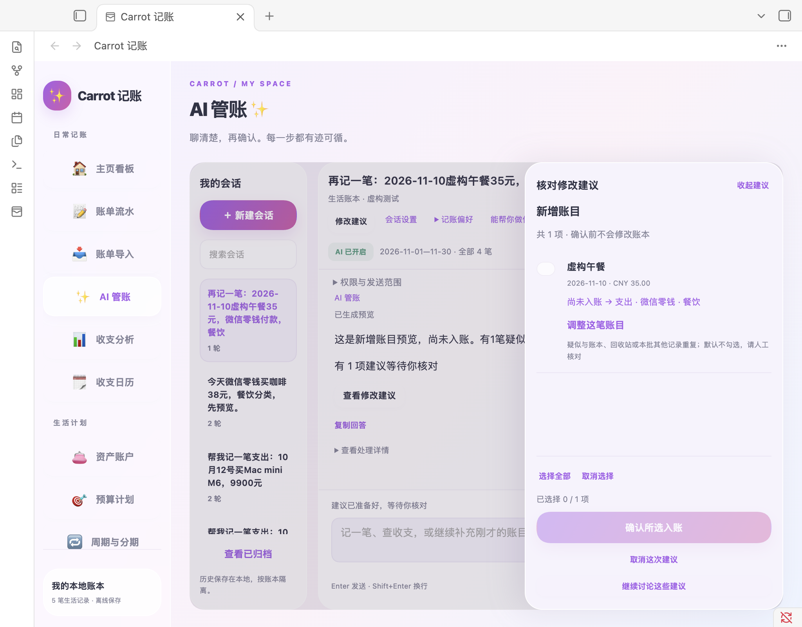
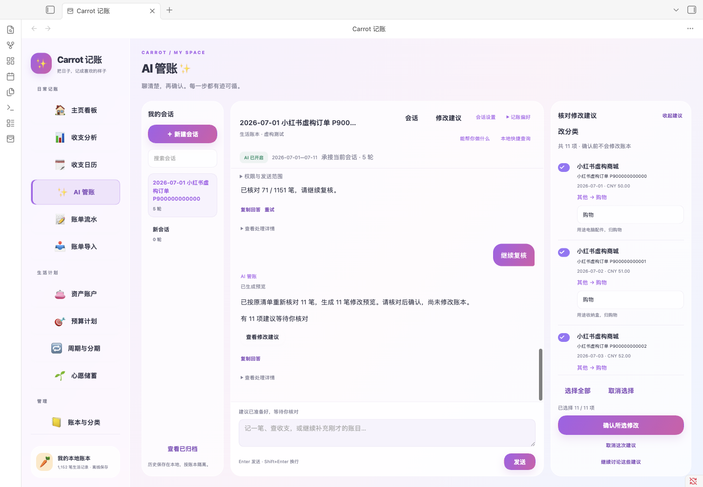
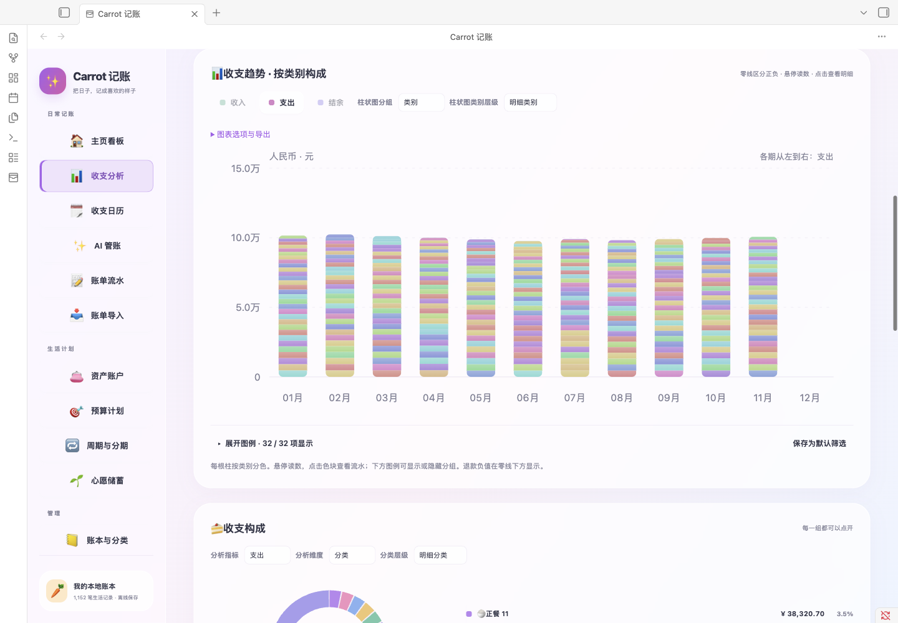
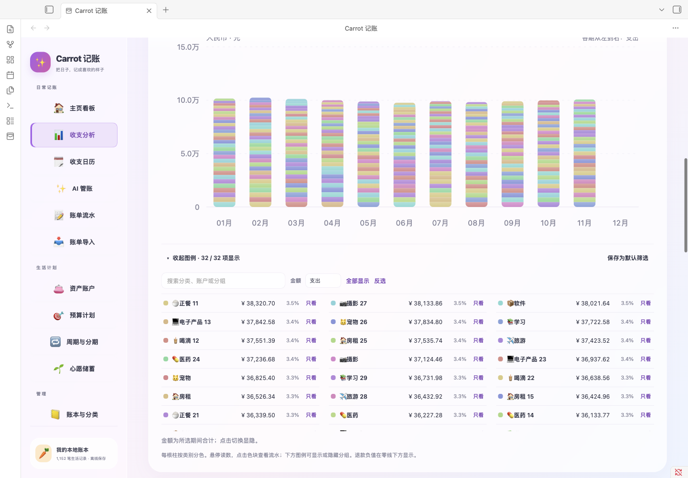
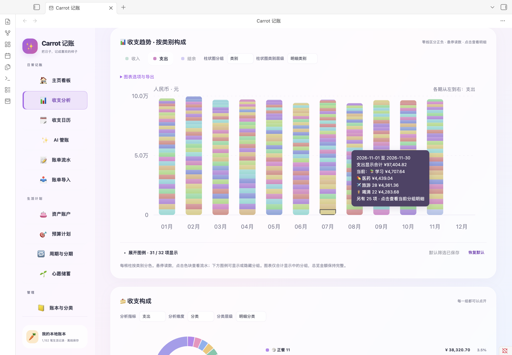
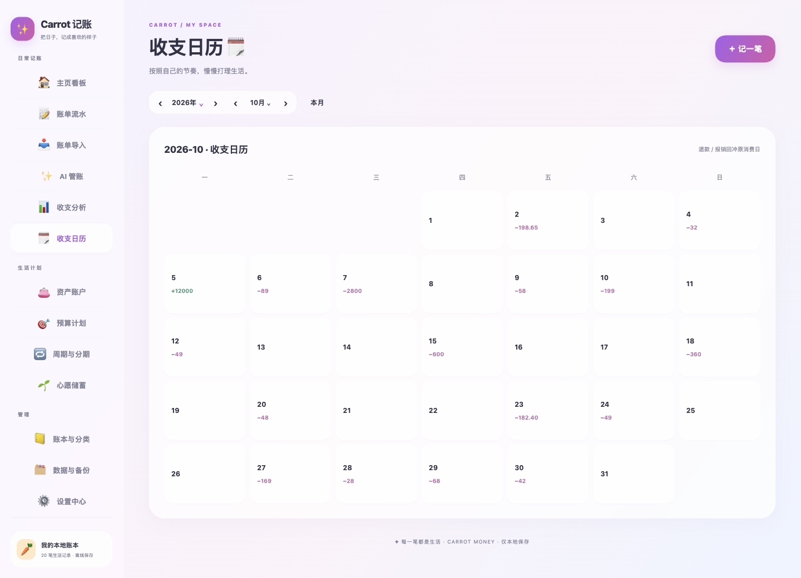
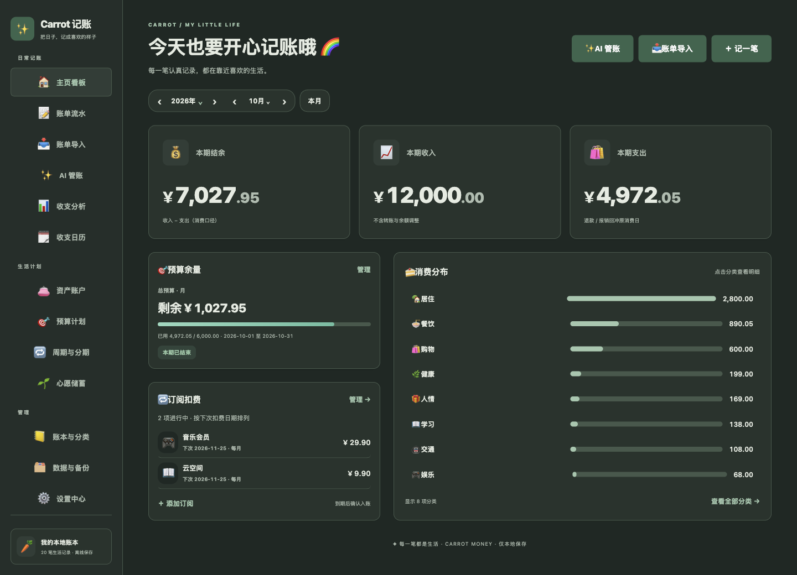

# 🥕 Carrot 记账

把日子，记成喜欢的样子。一个在 Obsidian 中使用的本地记账桌面，包含账单、账户、预算、消费分析、周期计划，以及可选的 AI 管账。

[下载最新版](https://github.com/carrot-tree/carrot-money/releases/latest) · [更新记录](CHANGELOG.md)


## 记账与看账

- 支出、收入、转账、退款与报销，支持多账户、外币与交易汇率。
- 月度收支分析、消费日历、预算、周期扣费和心愿目标。
- CSV 导入、重复检查、逐笔复核、回收站和本地备份。
- 柔雾紫与纸页绿两套外观，分别支持明暗模式。
- 可选 AI 查询与修改建议；分类、账户、删除等修改先展示逐笔预览，确认后才执行，并提供撤销。

## 更清楚、更好操作的记账界面

保留柔雾紫和纸页绿两套主题，统一导航图标与操作层级，放大说明文字和图表刻度。自选强调色会自动调整文字和按钮的明暗关系。编辑时保存操作常驻底部，输入错误会定位到字段并保留草稿。




设计检查参考 [UI UX Pro Max](https://github.com/nextlevelbuilder/ui-ux-pro-max-skill)，按中文 Obsidian 记账场景适配，保留用户自选分类 Emoji。

## 用 Agent 直接记账

例如：“10月12日买 Mac mini M6，9900元，微信零钱支付，分类电子产品。”Agent 会生成待确认预览。缺少账户或外币历史汇率时先追问；支持一笔、多笔、收入、内部转账、关联退款与报销到账。预览可以调整，确认后支持撤销。疑似重复默认不勾选。





可以通过对话设置循环预算或只调整某一期预算；明确查询账户余额时按真实资金发生日期计算，跨账本共用账户会提示前往资产账户查看完整余额。

## 只修改这几笔，范围就保持这几笔

把订单清单贴给 Agent，或先列出账目再说“把这些改一下”，Agent 会读取这些记录的最新内容并生成逐项预览。订单无法唯一匹配时先要求核对，不会把未列出的记录混进来。旧版误扩展为上千笔的复核任务，再点“继续复核”可按原清单重新核对；历史回答保留。



## 紧凑的分析界面

颜色图例默认折叠。展开后可以搜索和隐藏分组，再点“保存为默认筛选”；同一账本下次打开分析时会沿用。默认筛选保存图表类型、显示指标和隐藏分组，不固定日期范围。主页和分析分别保存。





图表提示会靠边避让，不挡住鼠标继续选择其他柱体。明细列表突出日期、分类和金额，按钮高度一致，删除操作独立放在末尾。



## 退款算在原消费日

真实流水保留到账日期，消费统计将关联退款冲回原消费日，账户余额仍按实际发生时间计算。

例如：10月15日付款2000元，10月18日分三笔退款1400元。消费日历将这单计为15日消费600元；18日的真实退款流水仍保留。详情同时列出原付、已退和净支出，原始付款金额不被自动改写。




## 编辑与恢复

已有账目的编辑页和详情页均可删除。确认时列出需一同移入回收站的关联退款／报销，整组记录可以恢复。




**以上图片均为真实 Obsidian 界面，账目为虚构演示数据。**

## 安装与更新

1. 从 [Releases](https://github.com/carrot-tree/carrot-money/releases/latest) 下载 `Carrot-Money-0.54.0.zip`。
2. 将压缩包中的 `carrot-money` 文件夹放入库的 `.obsidian/plugins/`。
3. 在 Obsidian「设置 → 第三方插件」启用「Carrot 记账」。更新已安装版本后，重新加载该插件。

也可以只下载同一 Release 的 `main.js`、`manifest.json`、`styles.css`，放入 `.obsidian/plugins/carrot-money/`。更新前备份这三个文件；更新时保留账本、聊天和草稿等用户文件。

## 本地数据与 AI

日常记账和统计可离线使用。账本、设置、聊天及导入复核草稿保存在当前 Obsidian 库的 `Carrot记账/` 中，不包含在插件安装包里。

AI 为可选功能，需自行配置服务商、模型与 Key。启用后，当前问题和本轮工具需要的账目字段会发送给所选服务商。只读查询与账本修改分开；生成修改建议不等于已执行。连接检测、能力检测与真实回答质量分别判断。

## 开发与验证

需要 Node.js，构建和测试无需安装依赖：

```sh
npm test
npm run build
```

源码位于 `src/`，构建入口为 `build.js`，发布运行文件为 `main.js`。当前包含80个源码模块、19个测试文件、354项自动回归。

0.54.0 在独立虚构 Obsidian 库中检查13页、两套主题与明暗模式，覆盖375/768/1024/1440宽度、键盘操作、触控尺寸模拟、减少动态效果和桌面200%缩放。本轮聚焦界面，未调用真实模型服务。

上一版0.53.0 使用真实 OpenCode Go（DeepSeek V4.1 Flash）验证具体清单、自然追问和旧断点恢复；在独立虚构 Obsidian 库中完成6组定向界面验收，以及真实模型预览、确认和撤销。桌面模拟宽度覆盖1440、1024、720、390；真实手机、iPad、系统文件选择器和其他模型服务商未在本轮验收。

[详细验证范围](https://github.com/carrot-tree/carrot-money/blob/v0.54.0/docs/verification.md)
