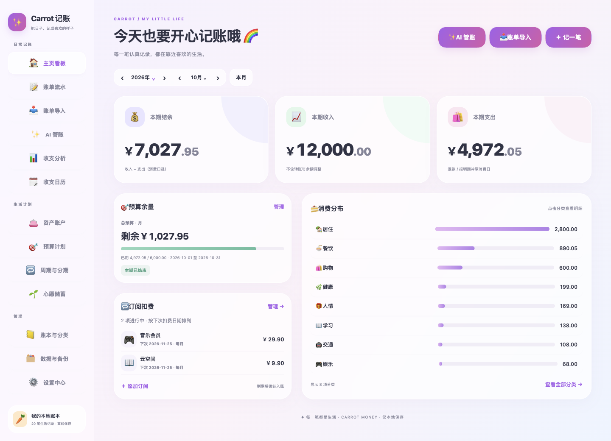
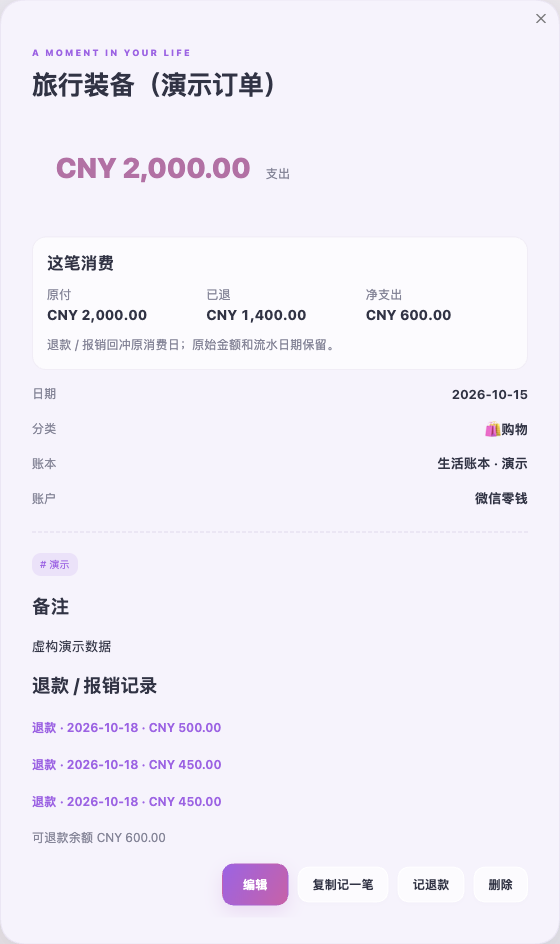

# 🥕 Carrot 记账

把日子，记成喜欢的样子。一个在 Obsidian 中使用的本地记账桌面，包含账单、账户、预算、消费分析、周期计划，以及可选的 AI 管账。

[下载最新版](https://github.com/carrot-tree/carrot-money/releases/latest) · [更新记录](CHANGELOG.md)



## 记账与看账

- 支出、收入、转账、退款与报销，支持多账户、外币与交易汇率。
- 月度收支分析、消费日历、预算、周期扣费和心愿目标。
- CSV 导入、重复检查、逐笔复核、回收站和本地备份。
- 柔雾紫与纸页绿两套外观，分别支持明暗模式。
- 可选 AI 查询与修改建议；分类、账户、删除等修改先展示逐笔预览，确认后才执行，并提供撤销。

## 退款算在原消费日

真实流水保留到账日期，消费统计将关联退款冲回原消费日，账户余额仍按实际发生时间计算。

例如：10月15日付款2000元，10月18日分三笔退款1400元。消费日历将这单计为15日消费600元；18日的真实退款流水仍保留。详情同时列出原付、已退和净支出，原始付款金额不被自动改写。




## 编辑与恢复

已有账目的编辑页和详情页均可删除。确认时列出需一同移入回收站的关联退款／报销，整组记录可以恢复。


**以上图片均为真实 Obsidian 界面，账目为虚构演示数据。**

## 安装与更新

1. 从 [Releases](https://github.com/carrot-tree/carrot-money/releases/latest) 下载 `Carrot-Money-0.51.0.zip`。
2. 将压缩包中的 `carrot-money` 文件夹放入库的 `.obsidian/plugins/`。
3. 在 Obsidian「设置 → 第三方插件」启用「Carrot 记账」。更新已安装版本后，重新加载该插件。

也可以只下载同一 Release 的 `main.js`、`manifest.json`、`styles.css`，放入 `.obsidian/plugins/carrot-money/`。更新前备份这三个文件；更新时保留账本、聊天和草稿等用户文件。

## 本地数据与 AI

日常记账和统计可离线使用。账本、设置、聊天及导入复核草稿保存在当前 Obsidian 库的 `Carrot记账/` 中，不包含在插件安装包里。

AI 为可选功能，需自行配置服务商、模型与 Key。启用后，当前问题和本轮工具需要的账目字段会发送给所选服务商。只读查询与账本修改分开；生成修改建议不等于已执行。连接检测、能力检测与真实回答质量分别判断。

## 开发与验证

需要 Node.js，构建和测试无需安装依赖：

```sh
npm test
npm run build
```

源码位于 `src/`，构建入口为 `build.js`，发布运行文件为 `main.js`。当前包含76个源码模块、16个测试文件、301项自动回归。

0.51.0 的主要行为经过隔离虚构库中的 Obsidian 原生交互验收；主题和窄屏使用桌面容器／视口模拟。真实手机、iPad、系统文件选择器及本轮真实 AI 服务未作为已通过的验收项目。

[详细验证范围](https://github.com/carrot-tree/carrot-money/blob/v0.51.0/docs/verification.md)
