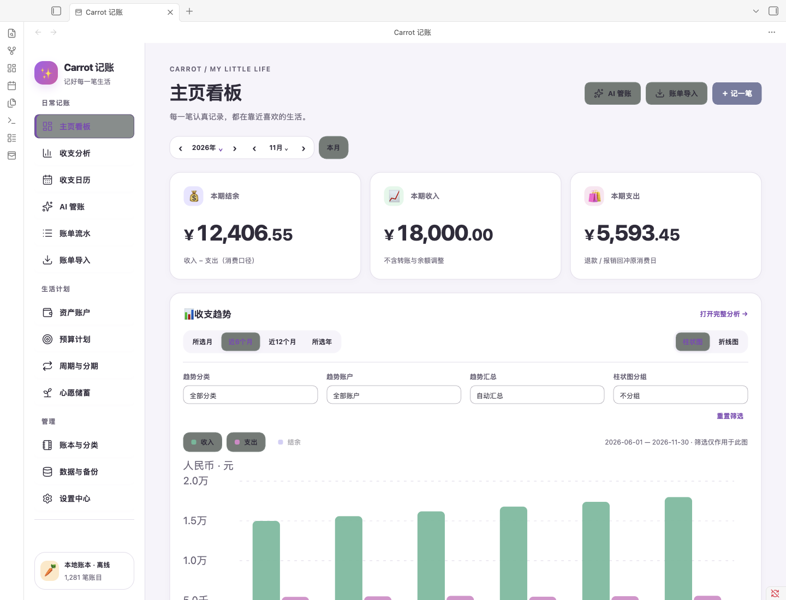
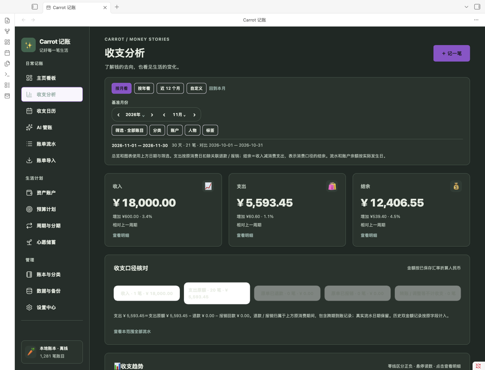
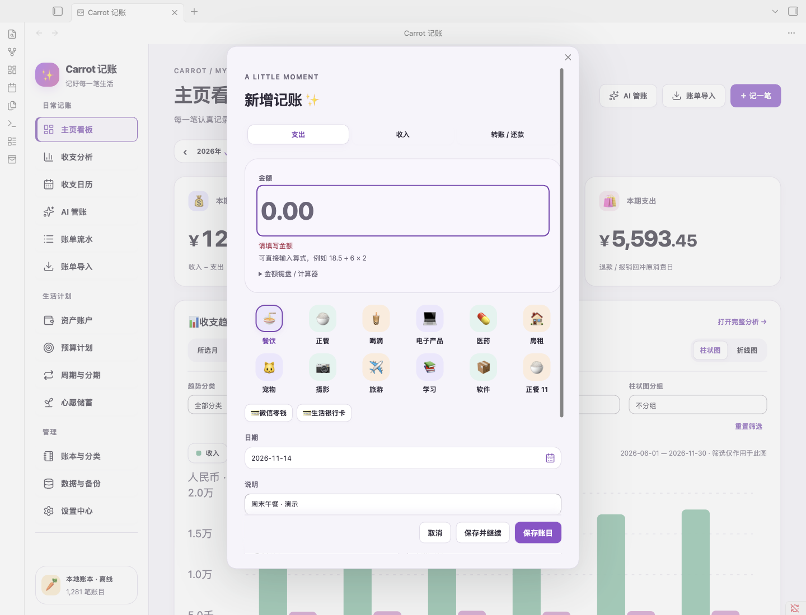
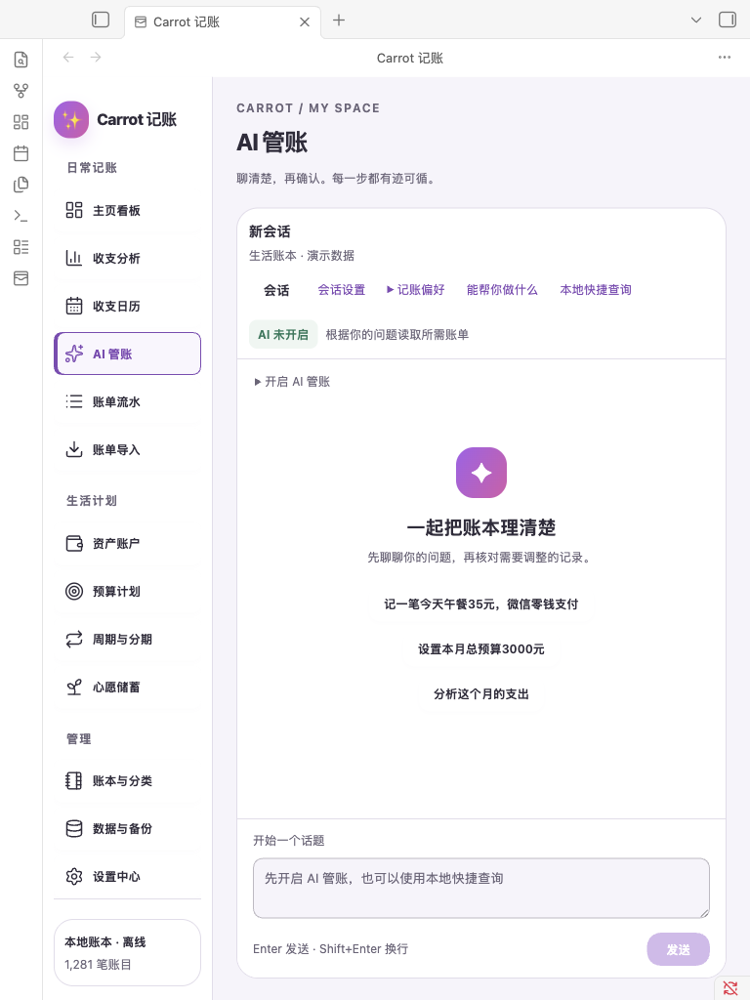
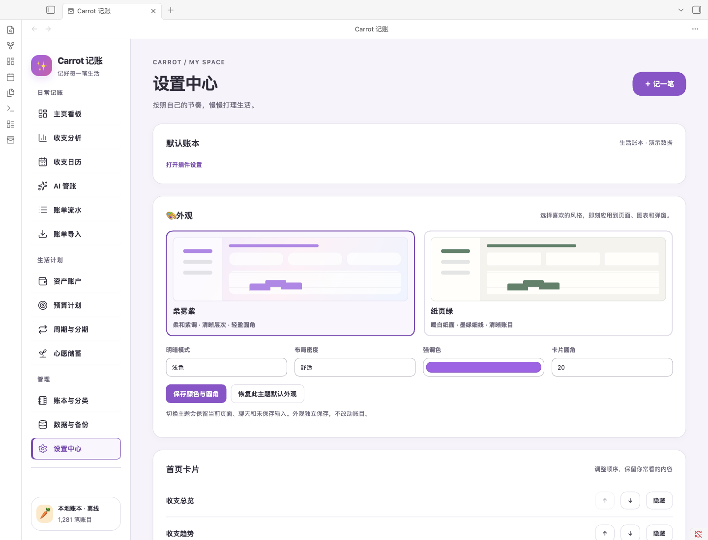

# Carrot 记账 0.54.0 验证范围

本轮按用户指定的 [UI UX Pro Max](https://github.com/nextlevelbuilder/ui-ux-pro-max-skill/tree/6ae86f61f520d6ca229d2f40e070410638c908c5) 检查可读性、操作层级、表单反馈和响应式布局。保留两套主题、用户分类 Emoji；未引入框架或网络字体。自动生成的营销布局、手写英文字体不适合本产品，未采用。

## 自动验证

- 354/354 项回归通过，11/11 项发布打包检查通过。
- 218 种强调色 × 两套主题，分别验证浅色/深色文本及按钮的对比度；包括白、黑、黄和高饱和色。
- 78 个原生页面/主题/宽度组合：13页 × 柔雾紫浅/深1440、纸页绿浅/深1440、柔雾紫浅768、纸页绿深375。可见文本对比度、辅助文字下限和控件横向溢出检查通过；彩色 Emoji 不按普通文字颜色计算，禁用状态不计入文字对比度检查。
- 新版本三个程序文件与独占测试库逐字节一致；源码安装包重新构建与 main.js 一致。

## 原生交互

在 Obsidian 1.13.7 独占虚构库中通过真实点击、输入和键盘事件验证14组操作：金额空值、无效算式、纠正后保存、通用表单空名称、主题点击切换、极浅强调色、会话抽屉、Escape 返回焦点、空会话停留顶部、减少动态效果、375px粗指针触控尺寸、桌面200%缩放、1024px紧凑布局和缺省账户图标。

编辑表单保存操作常驻底部；金额失败定位字段并保留草稿。平板/分屏下会话列表收起为抽屉，给正文更多空间。

## 边界

本轮是界面优化，未调用真实模型网络，也未重新验证手机或 iPad 真机；375/768/1024 均为桌面宽度/触控模拟。未执行系统文件选择器、屏幕阅读器和全部辅助技术验收。未宣称每个按钮或每种自定义配色的全部页面都已手工点击。

上一版0.53.0的真实OpenCode Go验证范围保留在该版本验证记录中。本轮不改账目计算、退款口径、Agent修改范围与入账规则。

## 演示图

所有图片为真实 Obsidian 截图，账目均为虚构演示数据。

